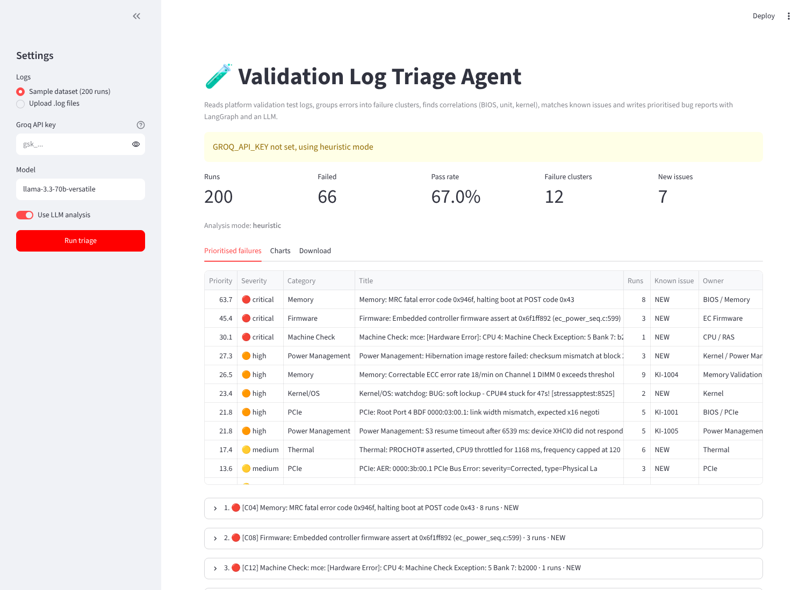
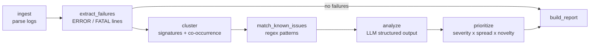

# Validation Log Triage Agent

An AI agent that reads hardware platform validation test logs, finds the real failures,
groups them across runs, spots correlations (BIOS version, unit, kernel), matches them against
a known issue list and writes prioritised bug reports with a likely root cause and next debug steps.

Built with **LangGraph**, **LangChain**, **Groq (Llama 3.3 70B)**, **Pydantic**, **scikit-learn** and **Streamlit**.



## Why

In a validation lab, hundreds of test runs (boot stress, S3/S4 power cycles, PCIe link training,
memory stress, thermal soak, USB enumeration) run every night. Engineers spend the morning reading
logs to answer the same questions:

- Which failures are real product bugs and which are lab or harness problems?
- Is this a new failure or an already known issue?
- Do the failures follow a BIOS version, a kernel, or one bad unit?
- Which failure should be debugged first, and by which team?

This project automates that first pass of triage.

## How it works



| Step | What it does |
|---|---|
| **ingest** | Parses each run log: header (platform, unit, suite, BIOS, kernel), footer (PASS / FAIL) and every log line. |
| **extract_failures** | Keeps ERROR and FATAL lines and turns each into a *signature* by removing numbers, hex values, PCIe BDF addresses, USB ports and unit names. |
| **cluster** | Merges signatures that are almost the same text (TF-IDF cosine) and signatures that appear in the same runs (run set Jaccard). One cluster = one failure mode. Then computes cross-run **correlations**, e.g. *"100% of affected runs have bios=B1.0.42 (only 23% of all runs)"*. |
| **match_known_issues** | Checks each cluster against `data/known_issues.json` and marks it as known or **NEW**. |
| **analyze** | Sends each cluster (statistics, example lines, warnings just before the error, correlations, known issue) to the LLM. The answer is forced into a Pydantic schema: title, category, severity, product bug or not, root cause, evidence, next steps, owner team, confidence. Runs 4 clusters in parallel. Falls back to a rule based analyzer if there is no API key or a call fails. |
| **prioritize** | Score = severity weight x number of affected runs x 1.5 if new x 0.3 if not a product bug. |
| **build_report** | Markdown and JSON report, plus the Streamlit dashboard. |

## Dataset

`data/generate_logs.py` creates a **synthetic** dataset that imitates a platform validation lab.
All platform names, devices and values are made up.

- 2 platforms (PLAT-A0, PLAT-B1), 12 units, 2 BIOS versions per platform, 2 kernels
- 7 test suites, 15 to 50 iterations each, with normal INFO traffic and harmless warnings
- 13 injected failure modes: PCIe link downtraining, PCIe AER flood, DDR training failure,
  correctable ECC storm, uncorrected machine check, S3 resume timeout, S4 image restore failure,
  thermal throttling, critical temperature shutdown, USB enumeration failure,
  embedded controller firmware assert, kernel soft lockup, lab SSH loss
- 12 of the 13 failure modes appear in the 200 run sample
- Realistic root causes are built in, so the agent has something real to find:
  PCIe downtraining only on **PLAT-B1 with BIOS B1.0.42**, DDR training failure only on **BIOS A0.1.18**,
  ECC errors only on unit **PLAT-A0-05**, hibernate failures only on **kernel 6.9.3**
- `data/ground_truth.csv` records the injected failure for every run, for evaluation

The included sample has 200 runs (66 failed). Generate a different one with:

```bash
python data/generate_logs.py --runs 500 --seed 42
```

## Results on the sample dataset

```
python evaluate.py --offline
```

| Metric | Result |
|---|---|
| Cluster purity (runs in a cluster that share one true failure mode) | 100% |
| Failure modes recovered | 12 / 12 |
| Category accuracy per failed run | 100% |
| Known issue matches that are correct | 5 / 5 |
| New failure modes flagged | 7 |

These numbers are on synthetic data, so they show that the pipeline works end to end,
not real world accuracy. The rule based mode is tuned to this dataset; the LLM mode adds
written root cause reasoning that uses the correlations and context lines.

## Run it

```bash
git clone <your repo url>
cd log-triage-agent
python -m venv .venv && source .venv/bin/activate   # Windows: .venv\Scripts\activate
pip install -r requirements.txt

cp .env.example .env        # then paste your free key from https://console.groq.com

python run_triage.py                 # CLI, writes reports/triage_report.md and .json
python run_triage.py --offline       # no LLM
streamlit run app.py                 # dashboard
python evaluate.py                   # metrics against ground truth
pytest -q                            # tests
```

## Project structure

```
log-triage-agent/
├── app.py                    Streamlit dashboard
├── run_triage.py             Command line entry point
├── evaluate.py               Metrics against ground truth
├── triage_agent/
│   ├── schemas.py            Pydantic models (RunMeta, LogEvent, FailureCluster, TriageAnalysis, ...)
│   ├── parser.py             Log parsing
│   ├── clustering.py         Signatures, clustering, correlations, known issue matching
│   ├── analyzer.py           Groq LLM analyzer + rule based fallback
│   ├── graph.py              LangGraph workflow
│   └── report.py             Markdown / JSON report
├── data/
│   ├── generate_logs.py      Synthetic dataset generator
│   ├── logs/                 200 sample run logs
│   ├── ground_truth.csv
│   └── known_issues.json
├── docs/                     Screenshots and example report
└── tests/
```

## Ideas for next steps

- Read logs straight from a test results server or a shared drive
- Add a RAG step over past bug reports so the agent can cite similar old bugs
- File the top issues automatically into Jira through an MCP server
- Track failure trends across nightly builds
